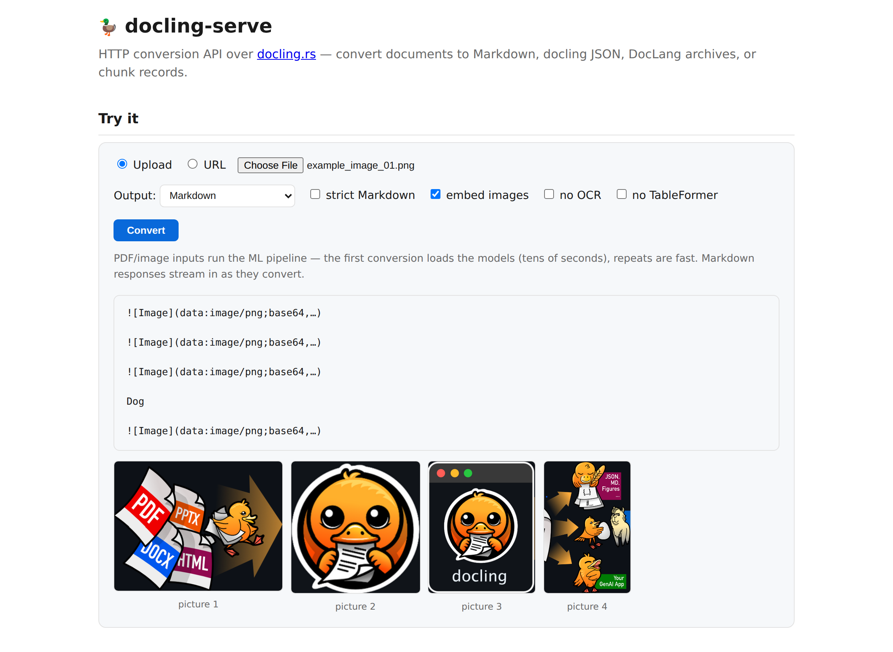

# docling-serve

The HTTP conversion API of [docling.rs](https://github.com/docling-project/docling.rs)
— the analogue of Python's `docling-serve`. A long-running
[axum](https://github.com/tokio-rs/axum) server over the `docling` converter:
one warm PDF/image pipeline (layout, OCR, TableFormer stay loaded) shared
across requests — repeat PDF conversions skip the model load, ~13× faster than
a cold call on the test fixtures — a semaphore bounding concurrent conversions, streamed
Markdown responses, async jobs, batch and ZIP inputs, and drop-in
compatibility with clients written against Python docling-serve
(Open WebUI, n8n, Dify, LangChain).

<p align="center">
  
</p>

```bash
cargo run --release -p docling-serve                 # 127.0.0.1:5001
# or, from the CLI crate: cargo run --release -p docling-cli --features serve -- serve

curl -F file=@paper.pdf localhost:5001/v1/convert                # Markdown
curl -F file=@report.docx 'localhost:5001/v1/convert?to=json'    # docling JSON
curl -F file=@page.html   'localhost:5001/v1/convert?to=chunks'  # chunk records
curl -F file=@a.pdf -F file=@b.docx localhost:5001/v1/convert    # batch → JSON results array
curl -H 'content-type: application/json' \
     -d '{"url": "https://example.com/doc.pdf", "to": "md"}' \
     localhost:5001/v1/convert     # fetch a URL (needs --allow-url-fetch)

id=$(curl -F file=@big.pdf localhost:5001/v1/convert/async | jq -r .task_id)
curl localhost:5001/v1/status/$id                                # pending|started|success|failure
curl localhost:5001/v1/result/$id                                # the output, once done
```

`GET /` serves the API docs plus an interactive test form, `GET /openapi.yaml`
the OpenAPI 3.1 description, `GET /health` and `GET /ready` the container
probes, `GET /metrics` Prometheus text. SIGTERM drains in-flight requests
before exit.

## Async jobs, batches and confidence

Long conversions don't have to hold the connection: `POST /v1/convert/async`
accepts the same request and returns a task id immediately — poll
`/v1/status/{id}`, fetch `/v1/result/{id}` (kept `--result-ttl` seconds,
default 10 min; at most `--queue-size` jobs queue at once). Several `file`
parts in one request convert as a batch with per-item status. PDF/image
responses carry a conversion-confidence report (docling-serve v1.25 parity):
an `X-Docling-Confidence` summary header (grades `poor`/`fair`/`good`/
`excellent` + layout/OCR/parse scores) on every format, and the full per-page
report under a top-level `confidence` key in `to=json` bodies. A started
job's `/v1/status/{id}` carries a `progress` object (#783): the document
under way (`document_index` of `documents_total`, `document_name`), its
`completed_pages` / `total_pages` and, during a picture pass, `enrichment`
counts — the converter's progress events, folded; a finished job keeps its
last counts.

## Routes

| Route | Purpose |
|---|---|
| `POST /v1/convert` | one `file` part, several (a batch), a ZIP, or a JSON body with `url` / `sources` / `target`; options as query parameters, multipart fields or JSON keys |
| `POST /v1/convert/async` · `GET /v1/status/{id}` · `GET /v1/result/{id}` | the same request as a job: a task id now, the result when done (kept `--result-ttl` seconds) |
| `POST /v1/convert/file` · `POST /v1/convert/source` (+ `/async`, `/v1alpha/…`) | Python docling-serve's routes and response shape (`ConvertDocumentResponse`), for its clients |
| `GET /v1/config` | the server's policies (`allow_url_fetch`, limits) |
| `GET /` · `GET /openapi.yaml` · `GET /health` · `GET /ready` · `GET /metrics` | docs and test form · OpenAPI · liveness · readiness (503 until `--warmup` finishes) · Prometheus |

## Request options

Options go as query parameters, multipart fields or JSON keys (the body
wins). The output options belong to serve; every conversion option is a
[`ConvertOptions`](../../docs/OPTIONS.md) field under its wire name.

| Option | Values | Meaning |
|---|---|---|
| `to` | `md` (default) \| `json` \| `html` \| `text` \| `dclx` \| `latex` \| `pandoc` \| `vtt` \| `chunks` \| `images` | the output. `images` skips conversion and rasterizes a PDF's pages to PNG — `{"pages": [{"page", "width", "height", "png_base64"}]}` — honouring `pages` and `scale` (0.1–4.0 px/pt, default 2.0), at most 100 pages per request (`DOCLING_RS_MAX_RASTER_PAGES`) |
| `images` | `placeholder` \| `embedded` | pictures in the Markdown: `<!-- image -->` or `data:` URIs |
| `pandoc_api_version` | `1.23`, … | the Pandoc API a `to=pandoc` caller expects |
| `pandoc_heading_depth` | `docling` (default) \| `source` | the `Header` depth a section heading gets in the `to=pandoc` AST (#848): docling's title-reserving `n + 1`, or the source's own `n` (a DOCX `Heading 1` is `Header 1`, as `pandoc -f docx` reads it) |
| `chunker` · `chunk_tokenizer` · `chunk_max_tokens` · `chunk_merge_peers` | `hierarchical` \| `hybrid` · a server-local path · int · bool | `to=chunks` configuration (#256) |
| `url` · `sources` · `target` | JSON body | a URL input (`--allow-url-fetch`), or docling's service shape (#139): `file` (base64) and `http` sources, `s3` / `azure_blob` / `google_cloud_storage` sources and targets with the `cloud` cargo feature, and the jobkit targets `zip` (one archive of the rendered outputs, nothing outbound) and `put` (HTTP-PUT each output to a pre-signed URL, behind `--allow-url-fetch`) — the `s3_pipeline` example in `/openapi.yaml` |
| every `ConvertOptions` field | its wire name | `strict`, `pages`, `no_ocr`, `password`, `ocr_*`, `heading_hierarchy`, the `do_*_enrichment` and `redact_*` switches, `document_timeout`, `image_sources`, `pipeline=vlm` + `vlm_*`, … — values and defaults in [`docs/OPTIONS.md`](../../docs/OPTIONS.md) |

Policies that stay with the server: URL inputs, `image_sources=remote` /
`fetch_images`, a request-supplied `vlm_endpoint` and `put` targets need
`--allow-url-fetch`; `image_sources=local` needs `--allow-local-images`;
`xbrl_taxonomy` and `chunk_tokenizer` are server-local relative paths. A
conversion cut by `document_timeout` answers `X-Docling-Status:
partial_success` + `X-Docling-Errors` (batch and async items carry `status`
and `errors`); `redact_pii` reports its counts in `X-Docling-Redaction`.


## Server flags

| Flag | Default | Meaning |
|---|---|---|
| `--addr HOST:PORT` | `127.0.0.1:5001` | bind address — loopback by default; front it with a policy proxy for anything wider |
| `--concurrency N` | 2 | conversions in flight; further requests queue |
| `--max-body-mb N` | 256 | upload cap |
| `--queue-size N` · `--result-ttl SECS` | 16 · 600 | async jobs queued or unfetched at once (429 beyond) · how long a finished result stays fetchable |
| `--warmup` | off | load the PDF/image models at startup; `/ready` is 503 until they are |
| `--idle-unload-secs N` | 0 = never (`DOCLING_RS_IDLE_UNLOAD_SECS`) | drop the warm PDF/image pipeline — its ONNX sessions and, on a GPU, their device memory — after N seconds without a PDF/image conversion (#842); the next one reloads it (~1 s on a GPU), `/ready` says `models: lazy` meanwhile |
| `--allow-url-fetch` | off | URL inputs, remote images, caller-supplied VLM endpoints, `put` targets. Private/loopback targets stay blocked (`DOCLING_RS_ALLOW_PRIVATE_IP_FETCH=1` opts out) and downloads are capped (`DOCLING_RS_MAX_FETCH_BYTES`) |
| `--allow-local-images` | off | accept `image_sources=local` (#646) |
| `--strict` | off | strict Markdown for requests that don't say |
| `--api-key KEY` | unset | `X-Api-Key` on every `/v1` route (#615); `DOCLING_SERVE_API_KEY` when the flag is absent — prefer it, a flag shows in the process list |
| `--max-memory-mb N` | the cgroup limit (`DOCLING_RS_MAX_MEMORY_MB`) | admission control (#263): above 85 % of it (`DOCLING_RS_MEMORY_WATERMARK_PCT`) new conversions get 503 + Retry-After instead of an OOM kill; `0` disables |

## Resources and observability

Thread pools are cgroup-quota-aware (#262; `DOCLING_RS_TF_INTRA` narrows the
shared TableFormer session) and the server runs with `DOCLING_RS_NO_ARENA=1`,
which measured ~3× lower warm RSS at no latency cost; glibc's mmap threshold
is pinned at startup (#669; every ONNX process does it since #871) so freed buffers leave the process instead of
piling up in its per-thread arenas — RSS holds flat across requests (~590 MB
over six mixed PDFs) where it used to creep (528 → 754 MB). An operator's
own `GLIBC_TUNABLES=glibc.malloc.mmap_threshold=…` wins. Observability mirrors
Python docling-serve (#297): `tracing` request logs (`RUST_LOG`), Prometheus
text on `GET /metrics` (request counts by status class, an in-flight gauge, a
latency histogram, conversions by outcome) and, with the opt-in `otel` cargo
feature and `OTEL_EXPORTER_OTLP_ENDPOINT` set, OTLP/gRPC request spans.
Container images, Compose files and tuning: [Deploy in a
container](../../README.md#deploy-in-a-container) and [`docs/DEPLOYMENT.md`](../../docs/DEPLOYMENT.md).

## Drop-in for docling-serve (Open WebUI, n8n, Dify, LangChain)

Clients written against Python docling-serve's API talk to this server
unchanged (#615). It serves upstream's routes next to its own `/v1/convert`:

| Route | Takes | Answers |
|---|---|---|
| `POST /v1/convert/file` | multipart `files` (repeatable) + option fields | docling's `ConvertDocumentResponse` |
| `POST /v1/convert/source` | JSON `{"sources": [{"kind": "file"\|"http", …}], "options": {…}, "target": {"kind": "inbody"\|"zip"}}` (also 0.x `file_sources` / `http_sources`) | the same |
| `POST /v1/convert/{file,source}/async` | the same | `TaskStatusResponse` (`task_id`, `task_status`, …) |
| `GET /v1/status/poll/{task_id}` · `GET /v1/result/{task_id}` | — | the task's status · its `ConvertDocumentResponse` |
| `/v1alpha/…` | aliases of the above for docling-serve 0.x clients | |

One document answers `{"document": {"filename", "md_content", "json_content",
"html_content", "text_content", "doctags_content", "doclang_content"},
"status", "errors", "processing_time", "timings"}` with the `to_formats`
asked for (default `md`) filled and the rest `null`; several documents (or
`target_type=zip`) a zip of `<stem>.<ext>` files. A document that fails to
convert is still a **200** with `status: "failure"` and the reason in
`errors[0].error_message`, which is where these clients look. Options take
upstream's names and types: `do_ocr`, `force_ocr`, `do_table_structure`,
`page_range`, `image_export_mode` (default `embedded`, as upstream),
`md_page_break_placeholder`, `do_pdf_heading_hierarchy`, `md_compact_tables`,
the `do_*_enrichment` switches, `document_timeout`, `images_scale`,
`pipeline=vlm`, `ocr_engine` (the Tesseract spellings select Tesseract;
EasyOCR / RapidOCR / ocrmac use the built-in PP-OCR) and `ocr_lang` (the
first code this build reads). Anything this server has no equivalent for —
`pdf_backend`, `table_mode`, `abort_on_error`, picture-description and preset
knobs — is accepted and ignored, so a client's extra parameters never fail a
conversion. This server's own option names (`strict`, `password`, …) work
there too. `doctags_content` stays `null`: there is no DocTags writer
(`doclang_content` carries its successor). `--api-key KEY`, or upstream's
`DOCLING_SERVE_API_KEY`, requires `X-Api-Key` on every `/v1` route; `/health`,
`/ready`, `/metrics` and the docs page stay open.

### Open WebUI

**Open WebUI**: *Admin Settings → Documents → Content Extraction Engine =
Docling*, *Docling Server URL* = `http://<host>:5001` (and the API key if you
set one). Its loader posts `files` with `image_export_mode=placeholder` and a
form-feed `md_page_break_placeholder`, and reads `document.md_content` split
into pages. Extra *Docling parameters* JSON (`{"do_ocr": true, "ocr_lang":
["en"]}`) is mapped where it means something here and ignored otherwise.

```bash
curl -F files=@report.pdf -F to_formats=md -F to_formats=text \
     localhost:5001/v1/convert/file | jq '.status, .document.text_content'
curl -H 'content-type: application/json' localhost:5001/v1/convert/source \
     -d '{"sources": [{"kind": "http", "url": "https://arxiv.org/pdf/2206.01062"}],
          "options": {"to_formats": ["md"], "do_ocr": false}}'  # needs --allow-url-fetch
```

## Cargo features

| Feature | Default | What it adds |
|---|---|---|
| `chunking` | on | tokenization-aware hybrid chunk records in `to=chunks` |
| `cloud` | off | S3 / Azure Blob / GCS request sources and output targets (`object_store`) |
| `otel` | off | OpenTelemetry trace export over OTLP (`OTEL_EXPORTER_OTLP_ENDPOINT`) |
| `cuda` · `tensorrt` · `directml` · `coreml` · `xnnpack` · `ort-load-dynamic` | off | ONNX Runtime execution providers for the ML pipeline, selected at runtime with `DOCLING_RS_EP` |
| `pdfium` · `heif` | off | pdfium as an opt-in PDF renderer · HEIC/HEIF input (links libheif) |

PDF, image, audio and video conversion need the ONNX models — fetch them with
`scripts/install/download_dependencies.sh` from the repository, or use the
container images, which carry them.

## Documentation

- [The project README](../../README.md) — what docling.rs converts, install
  options, benchmarks
- [`docs/DEPLOYMENT.md`](../../docs/DEPLOYMENT.md) — container images, Compose
  files, GPU stacks, resource sizing, air-gapped deployment
- [`docs/SECURITY.md`](../../docs/SECURITY.md) — the outbound-fetch policies,
  limits and every `DOCLING_RS_*` environment variable
- [`docs/OPTIONS.md`](../../docs/OPTIONS.md) — the conversion options and their
  wire names

## License

MIT, like the rest of docling.rs.
